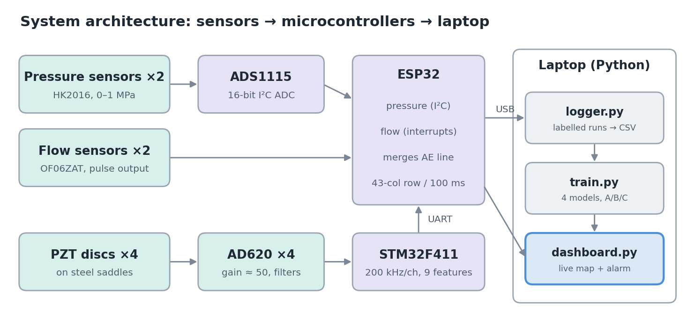
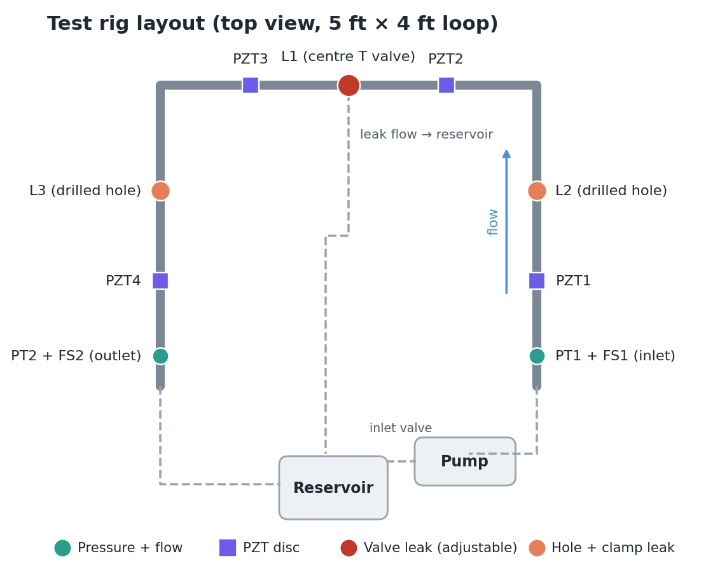
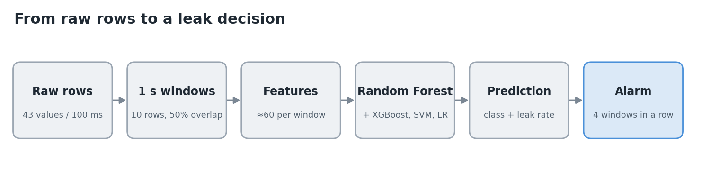

# ✈️ Aircraft Hydraulic Leak Detection System

**Machine-learning leak detection, quantification and localisation in a miniature hydraulic loop
using pressure, flow and acoustic-emission sensor fusion.**

Group 32 · Design Practicum (IC-202P22) · Indian Institute of Technology Mandi



---

## The problem

Aircraft hydraulic systems drive flight controls, landing gear and brakes. A leak wastes fluid,
lowers pressure and can disable an actuator. Aircraft monitor system-level pressure and reservoir
level, which shows *that* something is wrong but not *where*, so technicians must search manually
in dense, hard-to-reach bays.

## Our solution

A low-cost, lab-scale system that watches a miniature hydraulic loop and, in real time:

| Capability | How |
|---|---|
| **Detects** leaks | ML classifier on fused pressure, flow and acoustic features |
| **Quantifies** leak rate | Mass balance Q_in − Q_out + ML regressor trained on measured leak volumes |
| **Localises** the leak | Loudness pattern across 4 PZT discs, one per pipe segment |
| **Rejects** false alarms | Training on normal-but-disturbed runs + 2-second alarm persistence |
| **Alerts and logs** | Live Streamlit dashboard with map, alarm and event log |

It is a maintenance-assistance demonstrator, not an aircraft-certified system.

## How it works

1. **Sensing:** 2 pressure sensors (HK2016) and 2 flow sensors (OF06ZAT) at the loop inlet and outlet;
   4 PZT discs on steel saddles pick up the high-frequency noise of oil jetting through a leak.
2. **Acquisition:** an **ESP32** reads pressure (via a 16-bit ADS1115) and flow (interrupts); an
   **STM32F411** samples the four amplified PZT channels at 200 kHz each and computes 9 acoustic
   features per channel. The ESP32 merges everything into one 43-value row every 100 ms.
3. **Processing (laptop):** Python logs labelled experiments, turns each 1-second window into ≈60
   features, trains and compares four ML models, and runs the live dashboard.



**Test rig:** 12 mm mild steel loop (≈5 ft × 4 ft), ISO VG32 oil, 12 V diaphragm pump with PWM speed
control. Three leak points: **L1** an adjustable ball valve on the centre T, **L2/L3** drilled holes
sealed with rubber and hose clamps.

## Machine learning



- **Task:** 4-class classification (no leak / L1 / L2 / L3) + leak-rate regression.
- **Models compared:** Logistic Regression, SVM (RBF), **Random Forest (main)**, XGBoost.
- **Validation:** grouped 5-fold cross-validation **split by run**, physics baseline, and an
  **A/B/C sensor-fusion experiment** (pressure → + flow → + acoustics).
- **Metrics:** accuracy, precision, **leak recall**, macro F1, confusion matrix, leak-rate MAE,
  minimum detectable leak (3σ of flow imbalance).

## Quick start (no hardware needed)

```bash
git clone https://github.com/ohhaashis/Aircraft-Leak-Detection-System-.git
cd Aircraft-Leak-Detection-System-/python
pip install -r requirements.txt
python simulate.py --runs 24        # fake data to test the pipeline
python train.py                     # compare models, save the best one
streamlit run dashboard.py -- --replay data/raw/run_0002.csv
```

The dashboard opens in your browser and raises a leak alarm at L2 after about 2 seconds.
Simulated data proves the software works; its scores are **not** experimental results.
Full walkthrough, including the live rig demo: **[docs/07_demo_guide.md](docs/07_demo_guide.md)**.

## Repository structure

```
├── README.md
├── docs/
│   ├── Project_Report.pdf / .docx     Complete project report
│   ├── 01_problem_statement.md        Problem, objectives, test conditions, team
│   ├── 02_system_architecture.md      Layers, data flow, rig layout
│   ├── 03_hardware_and_circuits.md    Sensors, all circuits, PZT mount, pump/PWM, power
│   ├── 04_software_and_data.md        Software stack, code map, data format
│   ├── 05_machine_learning.md         Physics, features, models, validation, metrics
│   ├── 06_experiment_protocol.md      How to record labelled runs
│   ├── 07_demo_guide.md               Step-by-step demo (simulated and live)
│   ├── 08_troubleshooting.md
│   ├── 09_project_plan_and_team.md    Timeline, roles, status
│   ├── 10_sources_and_assumptions.md
│   └── images/
├── firmware/
│   ├── esp32/leak_daq/leak_daq.ino    Pressure + flow + AE merge → laptop
│   └── stm32/ae_firmware/             PZT sampling at 200 kHz + 9 features → ESP32 (+ test sketch)
├── python/
│   ├── config.py  logger.py  features.py  train.py  dashboard.py
│   ├── simulate.py  ae_reference.py  requirements.txt
├── hardware/
│   ├── BOM.csv                        Bill of materials
│   └── pin_map.md                     Every pin connection
└── data/README.md                     Data format and labels
```

## Project status

| Part | Status |
|---|---|
| Hydraulic loop | ✅ Built |
| Python pipeline (logger, features, training, dashboard) | ✅ Written, tested on simulated data |
| ESP32 firmware | ✅ Written, compiles · hardware testing pending |
| STM32 acoustic firmware | ✅ Written, compiles, maths verified vs Python reference · hardware testing pending |
| Leak points L2, L3 · PZT saddles | 🔧 To be built |
| Real data collection and results | ⏳ Pending |

## Team

| Member | Branch | Focus |
|---|---|---|
| Ashish Kumar | DSAI | ML, features, software ,STM32 firmware, dashboard |
| Aman Kumar | CSE | STM32 firmware, dashboard ,ESP32, pressure/flow, calibration  ,Acoustic|
| Nishant Thamman | ME | Hydraulic rig, mounts, leak points ,Acoustic , ESP32, power|
| Badavath Thirumalesh | EE | Acoustic front-end, power |
| Bhoomika | GE | ESP32, pressure/flow, calibration |
| Ananya Sharma | MSE | Data collection, report |

## Scope and limitations

Leaks are localised to **trained** positions (L1–L3), not arbitrary points. The PZT discs are resonant
40 kHz transducers, so acoustic features are relative rather than calibrated absolute measurements.
See [docs/10_sources_and_assumptions.md](docs/10_sources_and_assumptions.md).
